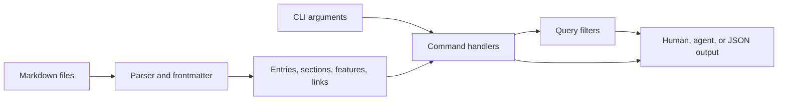

# Architecture and development

Updated: 2026-11-02

`mdd` parses local Markdown into a structural model, applies the selected command, and renders the result.



## Source layout

Updated: 2026-10-31

- `src/cli.rs` and `src/main.rs` define arguments and dispatch commands.
- `src/parse/` builds entries, heading ranges, feature summaries, frontmatter, and links. `pulldown-cmark` supplies Markdown events and byte offsets; the parser maps offsets to 1-based lines.
- `src/query/` walks directories and applies entry and section filters.
- `src/commands/` implements command-specific behavior. `src/output/` contains common renderers, although some commands render directly.
- `tests/` contains CLI, property, and snapshot tests. `examples/multipart_detail.rs` prints parser events for a multi-entry fixture.

## Build and test

Updated: 2026-10-31

Install a stable Rust toolchain, then run:

```bash
cargo build
cargo test
cargo clippy
```

To install the local checkout, run `cargo install --path .`. See the [command reference](commands.md) for user-visible behavior and current limitations.
